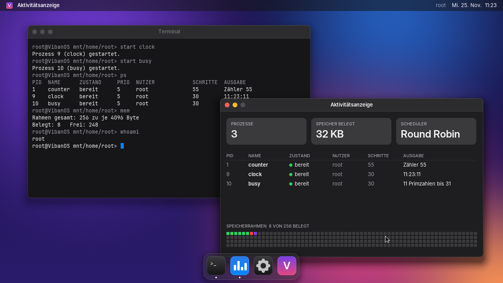

# VibanOS

Ein Betriebssystem in C#, gebaut mit [COSMOS](https://github.com/CosmosOS/Cosmos) 3.0 (C# Open Source Managed Operating System, Generation 3).

## Voraussetzungen

1. **.NET SDK 10.0** oder neuer
2. **COSMOS 3.0** mit dem Befehl `cosmos`:
   - Windows: `CosmosSetup-<version>-windows.exe` von https://github.com/CosmosOS/Cosmos/releases ausführen.
   - Linux und macOS:
     ```sh
     dotnet tool install -g Cosmos.Tools
     cosmos install
     ```
   Danach prüft `cosmos check` in einem neuen Terminal, ob alles da ist (Compiler, QEMU und die übrigen Werkzeuge bringt COSMOS mit).
3. Wer mag, eine IDE mit der Cosmos-Erweiterung: Visual Studio Code, Visual Studio 2026 (oder 2022 ab 17.14) oder JetBrains Rider ab 2025.3. Die Erweiterung baut und startet den Kernel aus der IDE.

Das Projekt ist auf COSMOS **3.0.99** festgelegt (`VibanOS/VibanOS.csproj`). Wer ein anderes Kit installiert hat, bringt seine Werkzeuge mit `cosmos update --version 3.0.99` auf denselben Stand. Auf eine neuere Version hebt das Projekt ein eigener Pull Request an (`cosmos update` im Ordner `VibanOS/`).

Besonderheiten für Windows auf ARM und für Macs mit Apple-Chip stehen in der [Installationsanleitung von COSMOS](https://cosmosos.github.io/articles/user/install.html).

## Bauen und starten

Alle Befehle laufen im Ordner `VibanOS/` (dort liegt `VibanOS.csproj`).

Einmalig legt man dort die virtuelle Festplatte an, eine leere Datei von 64 MB:

```sh
qemu-img create disk.img 64M
```

Danach, und nach jeder Änderung am Code:

```sh
cosmos build
cosmos run --disk disk.img
```

`cosmos build` übersetzt den Kernel und legt `VibanOS.iso` und `VibanOS.elf` in `output-x64/` ab. `cosmos run` startet die ISO in QEMU und zeigt im Terminal die serielle Ausgabe des Kernels. Dort stehen auch Fehlermeldungen, wenn das System nicht hochkommt.

Zwei Stolpersteine von COSMOS 3.0.99:

- Der Pfad zum Projekt darf **keine Leerzeichen** enthalten (also nicht `C:\Users\Max Mustermann\...`). `cosmos build` reicht ihn ohne Anführungszeichen weiter und scheitert sonst.
- Scheitert der Bau, zeigt `cosmos build -v` die vollständige Ausgabe des Compilers.

Wer in den Einstellungen die Auflösung umschalten will, startet mit der VMware-Grafik von QEMU:

```sh
cosmos run --disk disk.img -- -vga vmware
```

Ohne den Zusatz läuft VibanOS auf dem Startbild des Bootloaders (1280 × 720). Das kann COSMOS 3.0.99 nicht umschalten, die Einstellungen zeigen dann nur diese eine Auflösung.

VibanOS ist für x64 gedacht, die Projektdatei legt das fest. Die I/O-Ports für den Treiber `com1` gibt es nur dort.

### Die Festplatte

Auf `disk.img` liegen Dateien und Nutzer. Fehlt die Datei, bricht `cosmos run --disk disk.img` mit „Disk image not found“ ab. Ohne `qemu-img` tut es jede leere Datei dieser Größe: `truncate -s 64M disk.img` unter Linux, `mkfile -n 64m disk.img` unter macOS, `fsutil file createnew disk.img 67108864` unter Windows.

Beim ersten Start ist die Platte leer. Nach der Anmeldung als `root` richtet der Befehl `format` sie ein (Partitionstabelle und FAT-Dateisystem) und sichert die Nutzer darauf. `format` fasst nur eine Platte an, deren erstes Megabyte leer ist, und überschreibt deshalb keine vorhandenen Daten. Für einen Neuanfang löscht man `disk.img` und legt sie neu an.

Lässt sich die Nutzerdatei beim Start nicht lesen, meldet der Anmeldebildschirm das und lässt niemanden hinein. Hilft ein Neustart nicht, startet man einmal ohne `--disk` oder legt `disk.img` neu an.

Ohne `--disk` läuft das System trotzdem. Dateibefehle melden dann, dass kein Dateisystem da ist, und Nutzer gelten nur bis zum Ausschalten.

## Bedienung

Nach dem Start erscheint der Anmeldebildschirm. Beim allerersten Start legt man dort das Passwort für `root` fest und tippt es zur Sicherheit zweimal ein.
Danach öffnet sich der Schreibtisch mit Menüleiste, Dock und einem Terminal. `help` zeigt alle Befehle.

- Fenster zieht man an der Titelleiste, der rote Knopf schließt sie.
- Das Dock öffnet Dateien, Terminal, Aktivitätsanzeige (Prozesse und Speicher), Systemeinstellungen und „Über VibanOS“.
- Dateien blättert durch die Festplatte: Ein Klick wählt aus, ein zweiter Klick auf dieselbe Zeile öffnet den Ordner oder zeigt den Text der Datei. Pfeiltasten und Bild auf/ab wählen in der Liste und blättern im Text, die Eingabetaste öffnet, die Rücktaste geht zurück. Lange Zeilen bricht die Textansicht um wie das Terminal. „Neuer Ordner“ legt einen Ordner an, ein Klick auf die freie Fläche liest den Ordner neu. Umbenennen, Kopieren und Löschen gehen im Terminal mit `mv`, `cp` und `rm`, `df` zeigt den freien Platz. Namen mit Leerzeichen gehören dort in Anführungszeichen: `mv "Neuer Ordner" fotos`.
- In den Systemeinstellungen stellt man Auflösung, Akzentfarbe, Sekunden in der Menüleiste, Tastaturbelegung (Deutsch oder US) und einen großen Mauszeiger ein. Alles gilt sofort. Mit Festplatte merkt sich VibanOS die Einstellungen je Nutzer in `home/<name>/settings.txt` und stellt sie bei der Anmeldung wieder her. Ohne Festplatte gelten sie bis zur Abmeldung.
- Im Terminal blättern Bild auf und Bild ab, Pfeil auf und ab holen frühere Eingaben zurück.
- `shutdown` und `reboot` hängen die Festplatte vorher sauber aus. Am besten so beenden, statt das QEMU-Fenster einfach zu schließen. Unter `cosmos run` bleibt das Fenster danach mit dem letzten Bild stehen und kann geschlossen werden. Auch nach `reboot` startet dort nichts neu, dafür ruft man `cosmos run` noch einmal auf.
- Die Tastatur ist auf das deutsche Layout eingestellt, die Systemeinstellungen schalten auf US um. Passwörter tippt man immer mit dem deutschen Layout, am Anmeldebildschirm wie bei `passwd` und `useradd`: So passt ein Passwort auch dann noch, wenn jemand auf US umgestellt hat. Das deutsche Layout von COSMOS 3.0.99 hat Lücken: `#` und `'` lassen sich nicht tippen, und `<`, `>` und `|` liegen auf der Taste `#` (allein, mit Umschalt, mit AltGr). Die Num-Taste bleibt am besten aus, sonst liefern die Pfeiltasten Ziffern.
- Die Uhr zeigt die Zeit der virtuellen Maschine. QEMU stellt sie auf Weltzeit (UTC), sie geht also gegenüber der deutschen Zeit ein bis zwei Stunden nach.



## Projektstruktur

```
VibanOS.sln
VibanOS/
  VibanOS.csproj   COSMOS-Kernelprojekt
  Bootloader/      limine.conf: Starteintrag und Wunschauflösung
  Kernel.cs        Einstiegspunkt: Hardware einrichten, Eingaben weiterreichen, Bild anzeigen
  Platform/        Einzige weitere Stelle mit COSMOS-Aufrufen (Festplatte, Ports, Ein/Aus)
  Core/            OS (hält alle Teilsysteme), Texthelfer
  Design/          Tokens.cs: Farben, Abstände, Radien, Maße
  Graphics/        Zeichenfläche und Schrift (FontData.cs enthält die Schrift-Atlanten)
  Gui/             Schreibtisch, Fenster, Terminal, Dateien, Aktivitätsanzeige, Anmeldung
  Shell/           Shell und Befehle, ein Thema pro Datei in Shell/Commands/
  FileSystem/      Pfade und Rechteprüfung für Dateien
  Processes/       Prozesse und Scheduler
  Memory/          Simulierter RAM, Rahmen- und Seitentabellen
  Users/           Nutzer, Gruppen, Rechte
  Syscalls/        Systemaufrufe mit Modusprüfung
  Drivers/         Treiberverwaltung, COM1
  Ipc/, Sync/      Mailbox, Mutex, Semaphore
  Interrupts/      Interrupt-Verzeichnis, Signale
docs/
  architektur.md   Aufbau, Zuordnung der Aufgaben, Regeln für COSMOS
  design/          Designsheet mit allen Tokens
tools/
  Preview/         Selbsttest und Bildschirmfotos ohne VM
  Werkstatt/       Lokale Web-App: Branches holen, bauen und in QEMU starten
  make-fonts.py    Erzeugt die Schrift-Atlanten (Graphics/FontData.cs)
```

Mehr dazu in [docs/architektur.md](docs/architektur.md). Für alles Sichtbare gilt das [Designsheet](docs/design/designsheet.md).

## So fügst du einen neuen Befehl hinzu

1. In `VibanOS/Shell/Commands/` eine Klasse anlegen, die von `Command` ableitet:

   ```csharp
   namespace VibanOS.Cli.Commands
   {
       public class HalloCommand : Command
       {
           public override string Name { get { return "hallo"; } }
           public override string Description { get { return "Sagt Hallo"; } }

           public override void Execute(string[] args, Shell shell)
           {
               shell.WriteLine("Hallo " + Shell.Join(args, 0));
           }
       }
   }
   ```

   Der Namespace heißt `VibanOS.Cli.Commands`, obwohl der Ordner `Shell` heißt: Ein Namespace `VibanOS.Shell` käme der Klasse `Shell` in die Quere.
2. In `VibanOS/Shell/CommandList.cs` eine Zeile ergänzen: `shell.Register(new HalloCommand());`

`help` zeigt den Befehl dann von selbst. Ausgaben laufen über `shell.WriteLine` und `shell.Error`, nicht über `Console`, weil das Terminal ein Fenster ist. Befehle dürfen nicht auf Eingaben warten. Für Rückfragen gibt es `shell.Ask(...)`, ein Beispiel steht in `UserCommands.cs`.

## Prüfen ohne VM

```sh
dotnet run --project tools/Preview
```

Fährt den Kern und die Oberfläche ohne COSMOS hoch, prüft die Grundfunktionen und legt Bildschirmfotos in `preview/` ab. Das geht schnell und fängt Logikfehler ab. Vor einem Pull Request trotzdem mit `cosmos build` und `cosmos run` starten: Ob COSMOS den Code übersetzt und die Hardware mitspielt, zeigt nur die VM.

## Werkstatt: Branches per Klick bauen und starten

`tools/Werkstatt` ist eine kleine Web-App, die nur auf dem eigenen Rechner läuft. Sie holt einen Branch von GitHub, baut ihn mit `cosmos build` und startet ihn in QEMU. Sie braucht dasselbe wie oben (.NET 10 und COSMOS 3.0.99), auf dem Mac zusätzlich QEMU aus Homebrew (`brew install qemu`).

Starten:

- macOS: `tools/Werkstatt/start.command` im Finder doppelklicken
- Windows: `tools\Werkstatt\start.cmd` im Explorer doppelklicken
- überall im Terminal: `dotnet run --project tools/Werkstatt`

Der Browser öffnet sich mit http://127.0.0.1:5099. Die Werkstatt läuft, solange ihr Terminalfenster offen ist. Ctrl+C beendet sie und eine laufende VM. Ein zweiter Start öffnet nur den Browser.

Was sie kann:

- Alle Branches von GitHub mit letztem Commit, offenem Pull Request und Linear-Aufgabe (aus der VIB-Kennung im Namen), dazu ein Suchfeld.
- **Aktualisieren** holt Branches und Pull Requests neu und spult deinen Klon auf den Stand von GitHub vor (`git merge --ff-only`, nur vorspulen). Eigene Commits oder Änderungen, die im Weg wären, bleiben unangetastet, die Werkstatt zeigt dann die Meldung von git. Hat sich dabei die Werkstatt selbst geändert, baut sie sich neu, startet neu und die Seite lädt von selbst neu. Läuft gerade ein Bau oder eine VM, wartet der Neustart, bis sie fertig ist. Das geht mit den Startern oben; wer mit `dotnet run` startet, bekommt einen Hinweis und startet von Hand neu.
- **Holen, bauen und starten:** Jeder Branch bekommt einen eigenen Ordner neben dem Klon, `<Klon>-werkstatt/<branch>` (ein git worktree), mit eigener `disk.img`. Ein Start setzt diesen Ordner hart auf den Stand von GitHub zurück. Änderungen dort gehen also verloren, gearbeitet wird im eigenen Klon.
- **Dein Klon** baut und startet den Ordner, in dem die Werkstatt liegt, so wie er ist, auch mit nicht eingecheckten Änderungen. git fasst ihn dabei nicht an.
- Außerdem: nur starten (letzter Bau), nur bauen, Selbsttest (`tools/Preview`) mit den Bildschirmfotos, Festplatte leeren, Ordner öffnen und entfernen, `cosmos check`.
- Die Ausgabe läuft live mit: Bau, Selbsttest und die serielle Ausgabe des Kernels. „VM stoppen“ beendet QEMU sofort. Besser vorher `shutdown` im System tippen, dann ist die Festplatte sauber ausgehängt.
- In den Einstellungen: zusätzliche QEMU-Argumente (etwa `-accel whpx` unter Windows, unversucht) und ausführlicher Bau (`cosmos build -v`).

So startet die Werkstatt QEMU:

- macOS: das QEMU aus Homebrew direkt, mit denselben Einstellungen wie `cosmos run --disk disk.img`. Das Fenster lässt sich frei vergrößern, der Inhalt skaliert mit. Das mit COSMOS 3.0.99 gelieferte QEMU startet auf dem Mac nicht. Die Werkstatt gibt VibanOS die Größe des Bildschirms mit (`-fw_cfg name=opt/vibanos/screen,string=1470x923`, sichtbare Fläche unter der Kamera-Aussparung in Punkten) und startet es im Vollbild mit der Grafik `virtio-vga` in genau so vielen Pixeln (`-vga none -device virtio-vga,xres=2940,yres=1846 -full-screen`). QEMU zeigt dann jedes Pixel 1:1, und VibanOS zeichnet auf einem Retina-Bildschirm alles in doppelter Auflösung, auch die Schrift. Die Auflösung lässt sich so in VibanOS nicht umschalten. Ohne den Haken „Vollbild in voller Bildschirmauflösung“ in den Einstellungen der Werkstatt läuft es wie bisher mit `-vga vmware`: VibanOS nimmt die größte Auflösung im selben Seitenverhältnis, etwa 1440x900, und QEMU vergrößert sie im Vollbild (Cmd+F) ohne Glätten, umschaltbar im QEMU-Menü unter View > Zoom Interpolation.
- Windows und Linux: `cosmos run --disk disk.img -- -vga vmware`.

Auch hier gilt: Der Klon muss in einem Pfad ohne Leerzeichen liegen, sonst meldet die Werkstatt das vor dem Bau.

## Branch-Workflow

Wer mit Claude, ChatGPT oder einer anderen KI arbeitet: Die Regeln für die KI stehen in [AGENTS.md](AGENTS.md), die Anleitung auf der Doku-Seite unter [Implementierung](https://vibanos.cxdex.de/implementierung.html#mit-claude-oder-chatgpt-arbeiten).

1. Neue Branches immer von `development` abzweigen:
   ```sh
   git checkout development
   git pull
   git checkout -b feature/VIB-2-dateisystem
   ```
2. Der Branchname muss mit einem dieser Präfixe beginnen, sonst greift das Ruleset nicht:
   - `feature/` für neue Funktionen
   - `fix/` für Fehlerbehebungen
   - `rework/` für Umbauten und Refactorings
   Nach dem Präfix folgt die Kennung der Aufgabe aus Linear (z. B. `VIB-2`), siehe unten.
3. Änderungen pushen und einen Pull Request gegen `development` öffnen.
4. Der PR wird von @TheScoutSky reviewed und erst nach dessen Freigabe gemergt. Direkt auf `development` oder `main` wird nicht gepusht.

## Aufgaben und Fehler in Linear

Alle Aufgaben und Fehler werden im Linear-Projekt [VibanOS](https://linear.app/cxdex/project/vibanos-b87d853f1795) verwaltet, nicht als GitHub-Issues. Jede Aufgabe hat eine Kennung wie `VIB-2`.

### Aufgabe anlegen

1. In Linear im Team **VibanOS** und Projekt VibanOS mit **C** (oder „New issue“) eine neue Aufgabe anlegen.
2. Kurzen, eindeutigen Titel wählen, z. B. `Shell stürzt bei leerer Eingabe ab`.
3. Im Text beschreiben:
   - **Bei Fehlern:** Was wurde gemacht (Schritte zum Nachstellen)? Was sollte passieren? Was ist stattdessen passiert? Fehlermeldung oder Screenshot, VM (VMware/QEMU) und Branch.
   - **Bei neuen Funktionen:** Was soll das Feature können und warum wird es gebraucht?
4. Label setzen: das Thema (z. B. `Speicherverwaltung`) und bei Fehlern zusätzlich `Bug`. Projekt `VibanOS` auswählen und die Aufgabe jemandem zuweisen.

### Von der Aufgabe zum Pull Request

1. Aufgabe auf „In Progress“ setzen.
2. Branch von `development` erstellen, mit Präfix und Kennung im Namen:
   - Fehler → `fix/VIB-23-leere-eingabe`
   - Feature → `feature/VIB-2-dateisystem`
   - Umbau → `rework/VIB-1-shell-befehle`

   Der genaue Branchname und PR-Titel steht in jeder Aufgabe unter „Workflow“. Den von Linear über „Copy git branch name“ vorgeschlagenen Namen nicht verwenden, er hat nicht das nötige Präfix.
3. PR gegen `development` öffnen. Linear erkennt die Kennung im Branchnamen und verknüpft Branch und PR automatisch mit der Aufgabe. Nach dem Merge wird die Aufgabe automatisch auf „Done“ gesetzt.

### Fehler, die erst nach dem Merge auffallen

Ein bereits gemergter PR wird nicht wieder geöffnet oder weiterverwendet.

1. Neue Aufgabe mit Label `Bug` in Linear anlegen und darin den PR verlinken, der den Fehler eingeführt hat. Falls bekannt, die ursprüngliche Aufgabe unter „Related“ verknüpfen.
2. Einen neuen `fix/`-Branch mit der neuen Kennung vom aktuellen `development` erstellen, den Fehler beheben und einen neuen PR öffnen.
3. Ist der Fehler schwerwiegend und `development` dadurch unbenutzbar, kann der ursprüngliche PR auf GitHub über **Revert** zurückgenommen werden. Auch dieser Revert läuft als PR mit Review.
4. Ist der Fehler schon auf `main`, wird der Fix zuerst nach `development` gemergt und danach wie gewohnt von `development` nach `main` übernommen.

## Linear mit GitHub verbinden (einmalig)

1. **GitHub-Integration:** In Linear unter *Settings → Integrations → GitHub* verbinden, die Linear-App für die Organisation `DHGE2025` installieren und das Repo `VibanOS` auswählen. Dafür braucht man Owner-Rechte in der GitHub-Organisation.
2. **Persönliches Konto:** Jedes Teammitglied verbindet in Linear zusätzlich sein eigenes GitHub-Konto, damit PRs und Reviews der richtigen Person zugeordnet werden.
3. **Status-Automatik:** Im Team VibanOS unter *Settings → Teams → VibanOS → Workflow* die Git-Automationen einstellen, z. B. PR geöffnet → „In Review“, PR gemergt → „Done“.

## Weiterführend

- Doku von COSMOS 3.0: https://cosmosos.github.io/ (für VibanOS wichtig: Kernel Startup, Graphics, Keyboard, Mouse, Filesystem)
- Dateisystem, Grafik, Eingabe und Netzwerk stecken im Paket `Cosmos.Kernel.System`. Anleitungen im Netz zu `Cosmos.System2` oder IL2CPU beschreiben die ältere Generation und passen nicht mehr.
