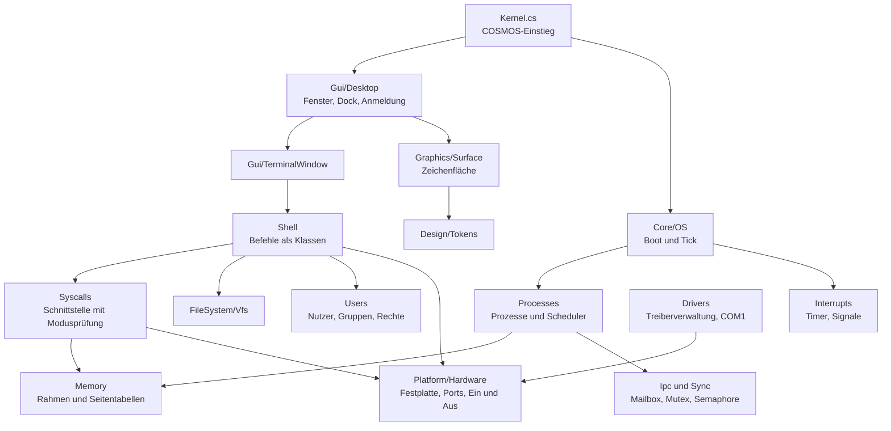

# Architektur von VibanOS

VibanOS ist ein Kernel in C# auf COSMOS 3.0 (Generation 3: .NET 10, übersetzt mit NativeAOT, Start über den Bootloader Limine per BIOS oder UEFI). Dieses Dokument zeigt, welche Teile es gibt, wie sie zusammenhängen und wo welche Aufgabe aus Linear ihren Platz hat.

## Überblick



## Die Kernel-Schleife

COSMOS ruft erst `Kernel.BeforeRun()` auf (Festplatte einhängen, Teilsysteme starten, Bildschirm holen) und dann `Kernel.Run()`. Darin läuft die Schleife von VibanOS, bis das System stoppt. Ein Durchlauf (`Kernel.Frame`) macht drei Dinge:

1. Tastatur und Maus lesen und an `Desktop` weiterreichen.
2. `OS.Tick()`: Timer-Tick zählen und einen Prozess einen Schritt arbeiten lassen.
3. `Desktop.Frame()`: Hat sich etwas geändert, wird neu gezeichnet und das Bild angezeigt.

Danach pausiert die Schleife 10 ms, damit sie die CPU nicht ständig voll auslastet. Scheitert ein Durchlauf mit einer Ausnahme, steht die Meldung im Terminal und im seriellen Protokoll, und es geht weiter. Erst nach drei Fehlern in Folge gibt der Kernel auf, COSMOS zeigt den Fehler dann an und hält an.

Daraus folgt die wichtigste Regel: **Nichts darf blockieren.** Kein `Console.ReadLine`, keine Warteschleifen. Ein Befehl, der eine Antwort braucht, nutzt `shell.Ask(...)`. Ein Prozess, der lange rechnet, erledigt pro `Step()` nur ein kleines Stück.

## Zwei Schichten

- **COSMOS-abhängig** sind nur `Kernel.cs` und `Platform/Hardware.cs`.
- **Alles andere** ist normales C# und läuft auch auf einem gewöhnlichen PC. `tools/Preview` nutzt das: Es fährt das System ohne VM hoch, prüft die Grundfunktionen und speichert Bildschirmfotos.

Wer neue Hardware anspricht, ergänzt eine Methode in `Hardware` (und in der Attrappe in `tools/Preview/Program.cs`), statt COSMOS-Klassen quer durch den Code zu verwenden.

## Festplatte und Dateien

`Hardware.MountDisk()` hängt beim Start die erste FAT-Partition unter `/mnt` ein. Danach arbeitet der ganze Code mit den normalen .NET-Klassen `File` und `Directory`, `Vfs` kümmert sich um Pfade und Rechte. Auf der Platte liegen `system/` (die Nutzerdatei, nur für Administratoren) und `home/<name>/`.

Zwei Eigenheiten von FAT prägen die Rechteprüfung in `Vfs.CanAccess`: Groß- und Kleinschreibung zählt nicht, und jeder lange Name hat einen zweiten, kurzen (aus `system` wird `SYSTEM~1`), unter dem dieselbe Datei erreichbar ist. Deshalb vergleicht die Prüfung ohne Rücksicht auf die Schreibweise, und Pfade mit `~` sind Administratoren vorbehalten. Wer die Prüfung für VIB-18 ausbaut, muss beides erhalten.

Die Nutzerdatei wird nie an Ort und Stelle überschrieben. `UserManager.Save()` schreibt sie vollständig nach `users.txt.new` und benennt sie dann um. Scheitert das Schreiben, bleibt die bisherige Datei gültig. Eine leere Nutzerdatei hieße beim nächsten Start Ersteinrichtung, also `root` ohne Passwort. Aus demselben Grund führt ein Lesefehler nicht zur Ersteinrichtung: `UserManager.LoadError` bleibt gesetzt, die Datei wird nicht überschrieben, und der Anmeldebildschirm lässt niemanden hinein.

`mv` und `rm` fassen nichts an, auf dessen festen Pfad sich das System verlässt (`Vfs.IsFixed`: die Wurzel, `system` samt der Nutzerdatei darin, `home` und die Home-Ordner der Nutzer). Das gilt auch für Administratoren: Ohne die Nutzerdatei begänne der nächste Start mit der Ersteinrichtung. Andere Ordner in `home`, etwa ein dort mit „Neuer Ordner“ angelegter, sind nicht fest, sonst würde sie niemand wieder los. Dasselbe gilt für eine Datei, die an der Stelle eines Home-Ordners liegt. `mv` verschiebt außerdem keinen Ordner in sich selbst und nicht den Ordner, in dem die Shell steht. Die Dateibefehle nehmen genau so viele Namen, wie sie brauchen (`rm` einen, `cp` und `mv` zwei): Ein Name mit Leerzeichen ohne Anführungszeichen zerfiele sonst still in mehrere, und `rm Neuer Ordner` löschte „Neuer“. `cp` und `mv` überschreiben nichts und lehnen ab, wenn Quelle und Ziel derselbe Pfad sind. Dabei zählt die Schreibweise nicht, weil sie auf FAT nicht zählt: `mv a.txt A.txt` träfe dieselbe Datei. Einen Ordner verschiebt `mv` auch nicht über einen Pfad mit `~`: Unter seinem Kurznamen (`daten` ist auch `DATEN~1`) erkennen diese Prüfungen denselben Ordner nicht wieder, und der Treiber ließe einen Ordner, der in sich selbst geschoben wird, verschwinden. Pfade setzt `Vfs.Combine` zusammen, denn die Wurzel endet als einziger Ordner schon mit dem Trenner.

Die App Dateien (`Gui/FilesWindow.cs`) fragt für jeden Ordner und jede Datei dieselbe Prüfung `Vfs.CanAccess` wie das Terminal. Fenster bleiben bei einer Abmeldung offen, deshalb setzt sich Dateien zurück, sobald ein anderer Nutzer angemeldet ist: Sonst sähe er, was sein Vorgänger offen hatte. Die Liste liest sie beim Wechseln des Ordners, bei einem Klick auf die freie Fläche, beim Schließen einer Vorschau, nach „Neuer Ordner“ und wenn sich ein Eintrag nicht öffnen lässt. Nicht bei jedem Zeichnen und nicht bei jedem Klick auf eine Zeile: Der FAT-Treiber von COSMOS merkt sich keine Ordner, jede Dateigröße kostet dort einen eigenen Suchlauf über alle Ordner des Pfads. Aus demselben Grund fragt sie den freien Platz für die Statuszeile nur beim Wechseln des Ordners und nach „Neuer Ordner“ ab, dafür liest der Treiber die ganze Belegungstabelle. Die Vorschau liest höchstens die ersten 8 KB einer Datei (`Vfs.ReadStart`), damit eine riesige Datei nicht den Arbeitsspeicher füllt. Die Statuszeile nennt dann statt der Zeilenzahl den gelesenen Anfang, denn mehr kennt die Vorschau nicht. Lange Zeilen bricht sie um wie das Terminal. Liste und Vorschau blättern getrennt, nach dem Schließen einer Datei steht die Liste, wo sie war. Zur gewählten Zeile blättert die Liste erst beim Zeichnen, denn erst dort steht fest, wie viele Zeilen ins Fenster passen. Ist der gezeigte Ordner inzwischen im Terminal verschoben oder gelöscht worden, geht Dateien nach Hause und sagt es, statt den alten Pfad mit „Neuer Ordner“ wieder anzulegen.

Die Einstellungen (`Core/Settings.cs`) stehen je Nutzer in `home/<name>/settings.txt` als Zeilen `schlüssel=wert`. Die Einstellungen-App schreibt die Datei nach jeder Änderung, `Desktop.OnKey` lädt sie direkt bei der Anmeldung und stellt bei der Abmeldung die Grundwerte wieder her, damit niemand sein Passwort mit der Tastaturbelegung des Vorgängers tippt. Das geschieht bewusst dort und nicht beim Zeichnen: Eine gespeicherte Auflösung schaltet den Bildschirm um, und der bekommt dabei einen neuen Puffer. Fehlt die Datei oder ein Eintrag, gilt der Grundwert. Die Auflösung steht nur in der Datei, wenn der Nutzer eine gewählt hat. Die Tastatur stellt allein `Settings.ApplyKeyboard` um: auf die Belegung des Nutzers, aber auf die deutsche, solange das Terminal ein Passwort abfragt. Am Anmeldebildschirm gilt immer die deutsche, und ein mit US-Belegung gesetztes Passwort passte dort sonst nicht mehr.

Im Home-Ordner darf bisher jeder schreiben (Dateirechte kommen mit VIB-18), die Datei ist also keine vertrauenswürdige Quelle. `Settings.Load` liest deshalb höchstens 1 KB, wirft nie und übernimmt nur, was auch die Einstellungen-App zur Wahl stellt: eine Akzentfarbe aus `Settings.Accents` und eine Auflösung, die die Grafikkarte gerade anbietet und die `Settings.Usable` zulässt. Eine andere Zahl aus der Datei erreicht die Grafikkarte nie.

Eine neue, leere Platte hat weder Partitionstabelle noch Dateisystem. Der Befehl `format` ruft `Hardware.FormatDisk()` auf: MBR-Partitionstabelle, eine Partition, FAT (COSMOS wählt je nach Größe FAT12, FAT16 oder FAT32), einhängen. Er arbeitet nur, wenn das erste Megabyte der Platte leer ist, und überschreibt deshalb keine vorhandenen Daten. `shutdown` und `reboot` hängen die Platte vorher aus, erst das sichert alle Schreibvorgänge.

## Wo liegt was

| Aufgabe | Ordner | Steht schon | Offen |
| -- | -- | -- | -- |
| VIB-1 Shell-Befehle | `Shell/` | `Command`, `Shell`, `CommandList`, alle sechs Grundbefehle | Fertig bis auf Feinschliff |
| VIB-2 Dateisystem | `FileSystem/`, `Shell/Commands/FileCommands.cs`, `Platform/` | `Vfs` (Pfade, Rechteprüfung), Einhängen der Festplatte unter `/mnt`, `format` für eine leere Platte, `ls`, `cd`, `pwd`, `mkdir`, `touch`, `cat`, `write`, `rm`, `cp`, `mv`, `df`, Verzeichnis im Prompt, die App Dateien (`Gui/FilesWindow.cs`), Einstellungen je Nutzer in `home/<name>/settings.txt`, Anleitung im README | `rm -r`, Umbenennen und Löschen in der App Dateien |
| VIB-3 Multitasking | `Processes/` | `Process`, `ProcessManager`, Round Robin, `counter`/`clock`/`busy`, `ps` mit Ausgabe, `start`, `kill` | `block`, `unblock` |
| VIB-4 Dokumentation | `docs/` | dieses Dokument, Designsheet | Themenseiten, `befehle.md`, Vorführ-Skript |
| VIB-5 Rahmentabellen | `Memory/` | `PhysicalMemory`, `FrameTable`, `PageTable`, Übersetzung, Page Fault, `mem`, `frames`, `alloc` | `pagetable`, `free`, `translate` |
| VIB-6 Fragmentierung | `Memory/` | gemeinsamer simulierter RAM | Blockverwaltung, First/Best/Worst Fit, Kennzahlen, Befehle |
| VIB-7 Speicherschutz | `Memory/` | Rechte pro Seite, geprüftes `ReadByte`/`WriteByte`, Protokoll, Prozess endet bei Verstoß | `protect`, `peek`, `poke`, `memlog`, `memdemo`, gemeinsamer Speicher |
| VIB-8 Deadlocks | `Sync/` | `Mutex`, `Semaphore` mit Warteschlange und Blockieren, beendete Prozesse werden übersprungen | Verzeichnis aller Sperren (Freigabe beim Beenden), Ressourcenverwaltung, Erkennung, Banker, Demos, Befehle |
| VIB-9 Ports | `Drivers/`, `Platform/` | `Driver`, `DriverManager`, `Hardware.In`/`Out`, COM1-Treiber (115200 Baud wie das Protokoll von COSMOS), `drivers` | PC-Speaker, `driver start/stop`, `inb`, `outb`, `beep` |
| VIB-10 Senden und Empfangen | `Drivers/SerialDriver.cs` | `SendMessage`, `ReadByte`, `send` | Empfangspuffer, `receive`, `chat`, Prüfsumme |
| VIB-11 Systemaufrufe | `Syscalls/` | `SyscallNumber`, `SyscallTable`, `Syscall.Invoke`, Protokoll, neun Aufrufe, `syscalls`; `echo`, `time`, `shutdown`, `reboot` laufen darüber | `strace`, `syscall`, `Read`, `OpenFile` |
| VIB-12 Syscall-Berechtigungen | `Syscalls/`, `Processes/` | `ProcessMode`, `KernelOnly` je Aufruf, Ablehnung mit Fehlercode und Protokoll | `mode`, `runas`, `seclog` |
| VIB-13 Kommunikation | `Ipc/` | `Message`, `Mailbox` je Prozess, asynchrones `Send`, `TryReceive` | `SendSync`, blockierendes `Receive`, Demos, Befehle |
| VIB-14 Interrupts | `Interrupts/` | `InterruptManager` mit Zählern für Timer und Tastatur (aus der Kernel-Schleife gemeldet), `Signal`, `Process.OnSignal` (Stop, Cont, Term), `interrupts` | echter Timer über `Cosmos.Kernel.System.Timers`, IRQ4 für COM1, `uptime`, `signal`, `sleep` |
| VIB-15 Scheduling | `Processes/Scheduler.cs` | `IScheduler`, Round Robin mit Quantum, Statistikfelder am Prozess | FCFS, SJF, Prioritäten, Befehle, Vergleich |
| VIB-16 Mehrere Anwender | `Users/`, `Gui/LoginScreen.cs` | `User`, `UserManager`, Hash mit Salt, `users.txt`, Anmeldebildschirm mit Ersteinrichtung (Passwort zweimal) und Sperre nach drei Fehlversuchen, Home-Verzeichnis, `whoami`, `users`, `useradd`, `passwd`, `logout` | `userdel`, `su`, `login` |
| VIB-17 Rechteverwaltung | `Users/` | `Group`, `Permission`, `HasPermission`, `Command.Required`, abgesichert: `shutdown`, `reboot`, `useradd`, `format`, `kill` und `alloc` bei fremden Prozessen | `groups.txt`, Gruppenbefehle, `sudo` |
| VIB-18 Zugriffsbeschränkung | `FileSystem/Vfs.cs` | `Vfs.CanAccess` als zentrale Prüfung, alle Dateibefehle rufen sie auf. Der Ordner `system/` ist schon Administratoren vorbehalten, alles andere steht noch jedem offen | Metadaten, `chmod`, `chown`, `ls -l` |

## So fügst du etwas hinzu

**Einen Shell-Befehl:** Klasse von `Command` ableiten, `Name`, `Description` und `Execute` schreiben, in `Shell/CommandList.cs` eine Zeile ergänzen. Ausgaben gehen über `shell.WriteLine(...)` und `shell.Error(...)`. Braucht der Befehl ein Systemrecht, `Required` überschreiben. Beispiele stehen in `Shell/Commands/`.

**Einen Prozess:** Klasse von `Process` ableiten und `Step()` schreiben. Was der Prozess zeigen will, schreibt er in `Output`. Zum Starten in `StartCommand` eintragen.

**Einen Systemaufruf:** Nummer in `SyscallNumber`, Eintrag in `SyscallTable.RegisterDefaults()` mit der Angabe, ob er nur im Kernelmode erlaubt ist.

**Einen Treiber:** Klasse von `Driver` ableiten, in `OS.Boot()` registrieren. Portzugriffe laufen über `Hardware.In` und `Hardware.Out`.

**Bildschirm (VIB-37):** Beim Start liest `Settings.HostScreen` über `Drivers/FwCfg.cs` die Größe des Bildschirms, auf dem QEMU läuft (fw_cfg-Datei `opt/vibanos/screen`, die Werkstatt setzt sie auf dem Mac). `Settings.StartMode` wählt daraus die größte angebotene Auflösung im selben Seitenverhältnis, ohne Angabe 1280x720. Eine in den Einstellungen gewählte Auflösung gilt nach der Anmeldung weiter vorrangig. `Desktop.Frame` meldet in `DirtyX`/`DirtyY`/`DirtyWidth`/`DirtyHeight`, was sich geändert hat, und `Hardware.Present` schickt nur diesen Ausschnitt an die Grafikkarte. Bei einer reinen Mausbewegung ist das ein kleiner Ausschnitt um die alte und die neue Stelle des Zeigers statt des ganzen Bildes.

**Ein Fenster:** Klasse von `Window` ableiten und `DrawContent` schreiben, Symbol in `Gui/Icons.cs`, Eintrag in `Desktop.Open`. Wächst der Inhalt mit der Fenstergröße, `CanZoom` auf `true` setzen, dann vergrößert der grüne Knopf das Fenster. Öffnen, Schließen und Minimieren sind automatisch animiert (`Gui/Transition.cs`). Für das Aussehen gilt das [Designsheet](design/designsheet.md).

## Was unter COSMOS zu beachten ist

COSMOS 3.0 übersetzt den Kernel mit NativeAOT, dem Compiler von .NET selbst. Viele Einschränkungen der älteren Generation (IL2CPU) sind damit weggefallen. Diese Regeln bleiben:

- **Keine Reflection.** Der Kernel kennt sie nicht. Deshalb werden Befehle von Hand in `CommandList` eingetragen, und die Schriften sind als C#-Daten einkompiliert (`Graphics/FontData.cs`) statt als eingebettete Ressource.
- **Keine Sprach- und Ländereinstellungen.** Der Kernel läuft ohne Kulturdaten, Zahlen und Daten werden immer neutral formatiert. Deutsche Datumsangaben und feste Spaltenbreiten liefert `Core/Text.cs`.
- **COSMOS nur in `Kernel.cs` und `Platform/Hardware.cs`.** Alles andere muss ohne COSMOS bauen, sonst läuft `tools/Preview` nicht mehr.
- **Interne Teile von COSMOS meiden.** `Hardware.In`, `Hardware.Out` und `Hardware.Out16` greifen über `UnsafeAccessor` auf die internen I/O-Ports zu, weil COSMOS sie nicht öffentlich anbietet. Das ist der eine, dokumentierte Sonderfall. Er gilt nur auf x64 und kann mit einer neuen COSMOS-Version brechen. `Hardware.Present` nutzt die öffentliche, aber als Vorabversion gekennzeichnete Treiber-Schnittstelle (`IDisplay`, Warnung COSMOS0003 gezielt abgeschaltet).
- **Interrupt-Handler kurz halten:** nur zählen oder in einen Puffer schreiben.
- **Neues gegen die Doku von COSMOS 3.0 prüfen** (https://cosmosos.github.io/). Beispiele im Netz zu `Cosmos.System2` gelten für die alte Generation.

## Prüfen ohne VM

```sh
dotnet run --project tools/Preview
```

Das Programm spielt eine Sitzung durch (Ersteinrichtung, Festplatte einrichten, Befehle, Prozesse, Speicher, Sperren, Nutzerwechsel, Maus) und bricht mit einer Meldung ab, wenn eine Grundfunktion nicht mehr stimmt. Wer ein Teilsystem erweitert, ergänzt dort eine Prüfung. Es ersetzt nicht den Start mit `cosmos run`: Ob COSMOS den Code übersetzt und die Hardware mitspielt, zeigt nur die VM.
