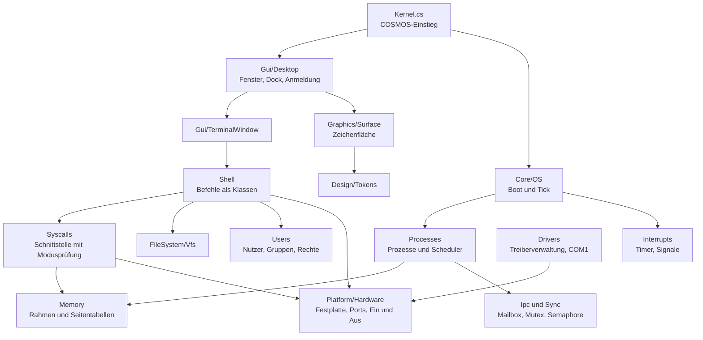

# Architektur von VibanOS

VibanOS ist ein Kernel in C# auf COSMOS 3.0 (Generation 3: .NET 10, übersetzt mit NativeAOT, Start über UEFI und Limine). Dieses Dokument zeigt, welche Teile es gibt, wie sie zusammenhängen und wo welche Aufgabe aus Linear ihren Platz hat.

## Überblick



## Die Kernel-Schleife

COSMOS ruft erst `Kernel.BeforeRun()` auf (Festplatte einhängen, Teilsysteme starten, Bildschirm holen) und dann `Kernel.Run()`. Darin läuft die Schleife von VibanOS, bis das System stoppt. Ein Durchlauf (`Kernel.Frame`) macht drei Dinge:

1. Tastatur und Maus lesen und an `Desktop` weiterreichen.
2. `OS.Tick()`: Timer-Tick zählen und einen Prozess einen Schritt arbeiten lassen.
3. `Desktop.Frame()`: Hat sich etwas geändert, wird neu gezeichnet und das Bild angezeigt.

Danach pausiert die Schleife 10 ms, damit sie die CPU nicht ständig voll auslastet. Scheitert ein Durchlauf mit einer Ausnahme, steht die Meldung im Terminal und im seriellen Protokoll, und es geht weiter. Erst nach drei Fehlern in Folge gibt der Kernel auf, COSMOS zeigt den Fehler dann an und hält an.

Daraus folgt die wichtigste Regel: **Nichts darf blockieren.** Kein `Console.ReadLine`, keine Warteschleifen. Ein Befehl, der eine Antwort braucht, nutzt `shell.Ask(...)`. Ein Prozess, der lange rechnet, erledigt pro `Step()` nur ein kleines Stück.

## Zwei Schichten

- **COSMOS-abhängig** sind nur `Kernel.cs` und `Platform/Hardware.cs`.
- **Alles andere** ist normales C# und läuft auch auf einem gewöhnlichen PC. `tools/Preview` nutzt das: Es fährt das System ohne VM hoch, prüft die Grundfunktionen und speichert Bildschirmfotos.

Wer neue Hardware anspricht, ergänzt eine Methode in `Hardware` (und in der Attrappe in `tools/Preview/Program.cs`), statt COSMOS-Klassen quer durch den Code zu verwenden.

## Festplatte und Dateien

`Hardware.MountDisk()` hängt beim Start die erste FAT-Partition unter `/mnt` ein. Danach arbeitet der ganze Code mit den normalen .NET-Klassen `File` und `Directory`, `Vfs` kümmert sich um Pfade und Rechte. Auf der Platte liegen `system/` (die Nutzerdatei, nur für Administratoren) und `home/<name>/`.

Eine neue, leere Platte hat weder Partitionstabelle noch Dateisystem. Der Befehl `format` ruft `Hardware.FormatDisk()` auf: MBR-Partitionstabelle, eine Partition, FAT (COSMOS wählt je nach Größe FAT12, FAT16 oder FAT32), einhängen. Er arbeitet nur, wenn der erste Sektor der Platte leer ist, und überschreibt deshalb nie vorhandene Daten. `shutdown` und `reboot` hängen die Platte vorher aus, erst das sichert alle Schreibvorgänge.

## Wo liegt was

| Aufgabe | Ordner | Steht schon | Offen |
| -- | -- | -- | -- |
| VIB-1 Shell-Befehle | `Shell/` | `Command`, `Shell`, `CommandList`, alle sechs Grundbefehle | Fertig bis auf Feinschliff |
| VIB-2 Dateisystem | `FileSystem/`, `Shell/Commands/FileCommands.cs`, `Platform/` | `Vfs` (Pfade, Rechteprüfung), Einhängen der Festplatte unter `/mnt`, `format` für eine leere Platte, `ls`, `cd`, `mkdir`, `touch`, `cat`, `write`, `rm`, Verzeichnis im Prompt, Anleitung im README | `df` (COSMOS bietet dafür `VfsManager.TryStatFs`) |
| VIB-3 Multitasking | `Processes/` | `Process`, `ProcessManager`, Round Robin, `counter`/`clock`/`busy`, `ps` mit Ausgabe, `start`, `kill` | `block`, `unblock` |
| VIB-4 Dokumentation | `docs/` | dieses Dokument, Designsheet | Themenseiten, `befehle.md`, Vorführ-Skript |
| VIB-5 Rahmentabellen | `Memory/` | `PhysicalMemory`, `FrameTable`, `PageTable`, Übersetzung, Page Fault, `mem`, `frames`, `alloc` | `pagetable`, `free`, `translate` |
| VIB-6 Fragmentierung | `Memory/` | gemeinsamer simulierter RAM | Blockverwaltung, First/Best/Worst Fit, Kennzahlen, Befehle |
| VIB-7 Speicherschutz | `Memory/` | Rechte pro Seite, geprüftes `ReadByte`/`WriteByte`, Protokoll, Prozess endet bei Verstoß | `protect`, `peek`, `poke`, `memlog`, `memdemo`, gemeinsamer Speicher |
| VIB-8 Deadlocks | `Sync/` | `Mutex`, `Semaphore` mit Warteschlange und Blockieren, beendete Prozesse werden übersprungen | Verzeichnis aller Sperren (Freigabe beim Beenden), Ressourcenverwaltung, Erkennung, Banker, Demos, Befehle |
| VIB-9 Ports | `Drivers/`, `Platform/` | `Driver`, `DriverManager`, `Hardware.In`/`Out`, COM1-Treiber (115200 Baud wie das Protokoll von COSMOS), `drivers` | PC-Speaker, `driver start/stop`, `inb`, `outb`, `beep` |
| VIB-10 Senden und Empfangen | `Drivers/SerialDriver.cs` | `SendMessage`, `ReadByte`, `send` | Empfangspuffer, `receive`, `chat`, Prüfsumme |
| VIB-11 Systemaufrufe | `Syscalls/` | `SyscallNumber`, `SyscallTable`, `Syscall.Invoke`, Protokoll, neun Aufrufe, `syscalls`; `echo`, `time`, `shutdown`, `reboot` laufen darüber | `strace`, `syscall`, `Read`, `OpenFile` |
| VIB-12 Syscall-Berechtigungen | `Syscalls/`, `Processes/` | `ProcessMode`, `KernelOnly` je Aufruf, Ablehnung mit Fehlercode und Protokoll | `mode`, `runas`, `seclog` |
| VIB-13 Kommunikation | `Ipc/` | `Message`, `Mailbox` je Prozess, asynchrones `Send`, `TryReceive` | `SendSync`, blockierendes `Receive`, Demos, Befehle |
| VIB-14 Interrupts | `Interrupts/` | `InterruptManager` mit Zählern für Timer und Tastatur (aus der Kernel-Schleife gemeldet), `Signal`, `Process.OnSignal` (Stop, Cont, Term), `interrupts` | echter Timer über `Cosmos.Kernel.System.Timers`, IRQ4 für COM1, `uptime`, `signal`, `sleep` |
| VIB-15 Scheduling | `Processes/Scheduler.cs` | `IScheduler`, Round Robin mit Quantum, Statistikfelder am Prozess | FCFS, SJF, Prioritäten, Befehle, Vergleich |
| VIB-16 Mehrere Anwender | `Users/`, `Gui/LoginScreen.cs` | `User`, `UserManager`, Hash mit Salt, `users.txt`, Anmeldebildschirm mit Ersteinrichtung (Passwort zweimal) und Sperre nach drei Fehlversuchen, Home-Verzeichnis, `whoami`, `users`, `useradd`, `passwd`, `logout` | `userdel`, `su`, `login` |
| VIB-17 Rechteverwaltung | `Users/` | `Group`, `Permission`, `HasPermission`, `Command.Required`, abgesichert: `shutdown`, `reboot`, `useradd`, `format`, `kill` und `alloc` bei fremden Prozessen | `groups.txt`, Gruppenbefehle, `sudo` |
| VIB-18 Zugriffsbeschränkung | `FileSystem/Vfs.cs` | `Vfs.CanAccess` als zentrale Prüfung, alle Dateibefehle rufen sie auf. Der Ordner `system/` ist schon Administratoren vorbehalten, alles andere steht noch jedem offen | Metadaten, `chmod`, `chown`, `ls -l` |

## So fügst du etwas hinzu

**Einen Shell-Befehl:** Klasse von `Command` ableiten, `Name`, `Description` und `Execute` schreiben, in `Shell/CommandList.cs` eine Zeile ergänzen. Ausgaben gehen über `shell.WriteLine(...)` und `shell.Error(...)`. Braucht der Befehl ein Systemrecht, `Required` überschreiben. Beispiele stehen in `Shell/Commands/`.

**Einen Prozess:** Klasse von `Process` ableiten und `Step()` schreiben. Was der Prozess zeigen will, schreibt er in `Output`. Zum Starten in `StartCommand` eintragen.

**Einen Systemaufruf:** Nummer in `SyscallNumber`, Eintrag in `SyscallTable.RegisterDefaults()` mit der Angabe, ob er nur im Kernelmode erlaubt ist.

**Einen Treiber:** Klasse von `Driver` ableiten, in `OS.Boot()` registrieren. Portzugriffe laufen über `Hardware.In` und `Hardware.Out`.

**Ein Fenster:** Klasse von `Window` ableiten und `DrawContent` schreiben, Symbol in `Gui/Icons.cs`, Eintrag in `Desktop.Open`. Für das Aussehen gilt das [Designsheet](design/designsheet.md).

## Was unter COSMOS zu beachten ist

COSMOS 3.0 übersetzt den Kernel mit NativeAOT, dem Compiler von .NET selbst. Viele Einschränkungen der älteren Generation (IL2CPU) sind damit weggefallen. Diese Regeln bleiben:

- **Keine Reflection.** Der Kernel kennt sie nicht. Deshalb werden Befehle von Hand in `CommandList` eingetragen, und die Schriften sind als C#-Daten einkompiliert (`Graphics/FontData.cs`) statt als eingebettete Ressource.
- **Keine Sprach- und Ländereinstellungen.** Der Kernel läuft ohne Kulturdaten, Zahlen und Daten werden immer neutral formatiert. Deutsche Datumsangaben und feste Spaltenbreiten liefert `Core/Text.cs`.
- **COSMOS nur in `Kernel.cs` und `Platform/Hardware.cs`.** Alles andere muss ohne COSMOS bauen, sonst läuft `tools/Preview` nicht mehr.
- **Interne Teile von COSMOS meiden.** `Hardware.In` und `Hardware.Out` greifen über `UnsafeAccessor` auf die internen I/O-Ports zu, weil COSMOS sie nicht öffentlich anbietet. Das ist der eine, dokumentierte Sonderfall. Er gilt nur auf x64 und kann mit einer neuen COSMOS-Version brechen.
- **Interrupt-Handler kurz halten:** nur zählen oder in einen Puffer schreiben.
- **Neues gegen die Doku von COSMOS 3.0 prüfen** (https://cosmosos.github.io/). Beispiele im Netz zu `Cosmos.System2` gelten für die alte Generation.

## Prüfen ohne VM

```sh
dotnet run --project tools/Preview
```

Das Programm spielt eine Sitzung durch (Ersteinrichtung, Festplatte einrichten, Befehle, Prozesse, Speicher, Sperren, Nutzerwechsel, Maus) und bricht mit einer Meldung ab, wenn eine Grundfunktion nicht mehr stimmt. Wer ein Teilsystem erweitert, ergänzt dort eine Prüfung. Es ersetzt nicht den Start mit `cosmos run`: Ob COSMOS den Code übersetzt und die Hardware mitspielt, zeigt nur die VM.
