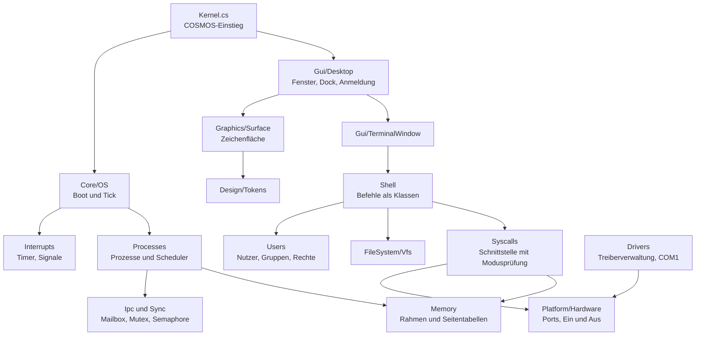

# Architektur von VibanOS

VibanOS ist ein COSMOS-Kernel in C#. Dieses Dokument zeigt, welche Teile es gibt, wie sie zusammenhängen und wo welche Aufgabe aus Linear ihren Platz hat.

## Überblick



## Die Kernel-Schleife

COSMOS ruft `Kernel.Run()` in einer Endlosschleife auf. Ein Durchlauf macht vier Dinge:

1. Tastatur und Maus lesen und an `Desktop` weiterreichen.
2. `OS.Tick()`: Timer-Tick zählen und einen Prozess einen Schritt arbeiten lassen.
3. `Desktop.Frame()`: Hat sich etwas geändert, wird neu gezeichnet und das Bild angezeigt.
4. Ab und zu den Heap aufräumen.

Daraus folgt die wichtigste Regel: **Nichts darf blockieren.** Kein `Console.ReadLine`, keine Warteschleifen. Ein Befehl, der eine Antwort braucht, nutzt `shell.Ask(...)`. Ein Prozess, der lange rechnet, erledigt pro `Step()` nur ein kleines Stück.

## Zwei Schichten

- **COSMOS-abhängig** sind nur `Kernel.cs` und `Platform/Hardware.cs`.
- **Alles andere** ist normales C# und läuft auch auf einem gewöhnlichen PC. `tools/Preview` nutzt das: Es fährt das System ohne VM hoch, prüft die Grundfunktionen und speichert Bildschirmfotos.

Wer neue Hardware anspricht, ergänzt eine Methode in `Hardware` (und in der Attrappe in `tools/Preview/Program.cs`), statt COSMOS-Klassen quer durch den Code zu verwenden.

## Wo liegt was

| Aufgabe | Ordner | Steht schon | Offen |
| -- | -- | -- | -- |
| VIB-1 Shell-Befehle | `Shell/` | `Command`, `Shell`, `CommandList`, alle sechs Grundbefehle | Fertig bis auf Feinschliff |
| VIB-2 Dateisystem | `FileSystem/`, `Shell/Commands/FileCommands.cs` | `Vfs` (Pfade, Rechte-Haken), `ls`, `cd`, `mkdir`, `touch`, `cat`, `write`, `rm`, Verzeichnis im Prompt | `df`, Anleitung für die virtuelle Festplatte |
| VIB-3 Multitasking | `Processes/` | `Process`, `ProcessManager`, Round Robin, `counter`/`clock`/`busy`, `ps`, `start`, `kill` | `block`, `unblock` |
| VIB-4 Dokumentation | `docs/` | dieses Dokument, Designsheet | Themenseiten, `befehle.md`, Vorführ-Skript |
| VIB-5 Rahmentabellen | `Memory/` | `PhysicalMemory`, `FrameTable`, `PageTable`, Übersetzung, Page Fault, `mem`, `frames`, `alloc` | `pagetable`, `free`, `translate` |
| VIB-6 Fragmentierung | `Memory/` | gemeinsamer simulierter RAM | Blockverwaltung, First/Best/Worst Fit, Kennzahlen, Befehle |
| VIB-7 Speicherschutz | `Memory/` | Rechte pro Seite, geprüftes `ReadByte`/`WriteByte`, Protokoll, Prozess endet bei Verstoß | `protect`, `peek`, `poke`, `memlog`, `memdemo`, gemeinsamer Speicher |
| VIB-8 Deadlocks | `Sync/` | `Mutex`, `Semaphore` mit Warteschlange und Blockieren | Ressourcenverwaltung, Erkennung, Banker, Demos, Befehle |
| VIB-9 Ports | `Drivers/`, `Platform/` | `Driver`, `DriverManager`, COM1-Treiber, `drivers` | PC-Speaker, `driver start/stop`, `inb`, `outb`, `beep` |
| VIB-10 Senden und Empfangen | `Drivers/SerialDriver.cs` | `SendMessage`, `ReadByte`, `send` | Empfangspuffer, `receive`, `chat`, Prüfsumme |
| VIB-11 Systemaufrufe | `Syscalls/` | `SyscallNumber`, `SyscallTable`, `Syscall.Invoke`, Protokoll, neun Aufrufe, `syscalls`; `echo`, `time`, `shutdown`, `reboot` laufen darüber | `strace`, `syscall`, `Read`, `OpenFile` |
| VIB-12 Syscall-Berechtigungen | `Syscalls/`, `Processes/` | `ProcessMode`, `KernelOnly` je Aufruf, Ablehnung mit Fehlercode und Protokoll | `mode`, `runas`, `seclog` |
| VIB-13 Kommunikation | `Ipc/` | `Message`, `Mailbox` je Prozess, asynchrones `Send`, `TryReceive` | `SendSync`, blockierendes `Receive`, Demos, Befehle |
| VIB-14 Interrupts | `Interrupts/` | `InterruptManager` mit Zählern, `Signal`, `Process.OnSignal`, `interrupts` | echter PIT-Timer, IRQ4 für COM1, `uptime`, `signal`, `sleep` |
| VIB-15 Scheduling | `Processes/Scheduler.cs` | `IScheduler`, Round Robin mit Quantum, Statistikfelder am Prozess | FCFS, SJF, Prioritäten, Befehle, Vergleich |
| VIB-16 Mehrere Anwender | `Users/`, `Gui/LoginScreen.cs` | `User`, `UserManager`, Hash mit Salt, `users.txt`, Anmeldebildschirm mit Ersteinrichtung und Sperre nach drei Fehlversuchen, Home-Verzeichnis, `whoami`, `users`, `useradd`, `passwd`, `logout` | `userdel`, `su`, `login` |
| VIB-17 Rechteverwaltung | `Users/` | `Group`, `Permission`, `HasPermission`, `Command.Required`, abgesichert: `shutdown`, `reboot`, `useradd`, `kill` fremder Prozesse | `groups.txt`, Gruppenbefehle, `sudo` |
| VIB-18 Zugriffsbeschränkung | `FileSystem/Vfs.cs` | `Vfs.CanAccess` als zentrale Prüfung, alle Dateibefehle rufen sie auf (erlaubt noch alles) | Metadaten, `chmod`, `chown`, `ls -l` |

## So fügst du etwas hinzu

**Einen Shell-Befehl:** Klasse von `Command` ableiten, `Name`, `Description` und `Execute` schreiben, in `Shell/CommandList.cs` eine Zeile ergänzen. Ausgaben gehen über `shell.WriteLine(...)` und `shell.Error(...)`. Braucht der Befehl ein Systemrecht, `Required` überschreiben. Beispiele stehen in `Shell/Commands/`.

**Einen Prozess:** Klasse von `Process` ableiten und `Step()` schreiben. Was der Prozess zeigen will, schreibt er in `Output`. Zum Starten in `StartCommand` eintragen.

**Einen Systemaufruf:** Nummer in `SyscallNumber`, Eintrag in `SyscallTable.RegisterDefaults()` mit der Angabe, ob er nur im Kernelmode erlaubt ist.

**Einen Treiber:** Klasse von `Driver` ableiten, in `OS.Boot()` registrieren. Portzugriffe laufen über `Hardware.In` und `Hardware.Out`.

**Ein Fenster:** Klasse von `Window` ableiten und `DrawContent` schreiben, Symbol in `Gui/Icons.cs`, Eintrag in `Desktop.Open`. Für das Aussehen gilt das [Designsheet](design/designsheet.md).

## Was unter COSMOS zu beachten ist

- Keine Reflection, kein LINQ, kein `async`.
- `Enum.ToString()`, Formatstrings wie `ToString("X4")` und `string.Format` mit Ausrichtung meiden. Dafür gibt es `Core/Text.cs`.
- `List.Contains`, `List.Remove(objekt)` und `Dictionary` meiden, stattdessen Schleife und `RemoveAt`.
- Ausnahmen immer als `catch (Exception e)` fangen.
- Interrupt-Handler kurz halten: nur zählen oder in einen Puffer schreiben.

## Prüfen ohne VM

```sh
dotnet run --project tools/Preview
```

Das Programm spielt eine Sitzung durch (Ersteinrichtung, Befehle, Prozesse, Speicher, Nutzerwechsel, Maus) und bricht mit einer Meldung ab, wenn eine Grundfunktion nicht mehr stimmt. Wer ein Teilsystem erweitert, ergänzt dort eine Prüfung. Es ersetzt nicht den Start in VMware oder QEMU: Ob COSMOS den Code übersetzt und die Hardware mitspielt, zeigt nur die VM.
