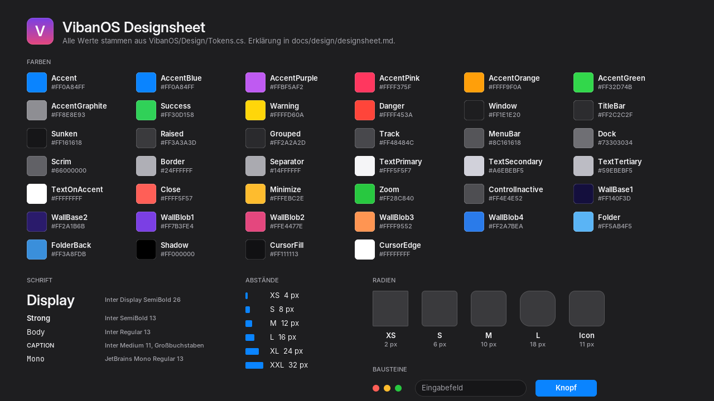
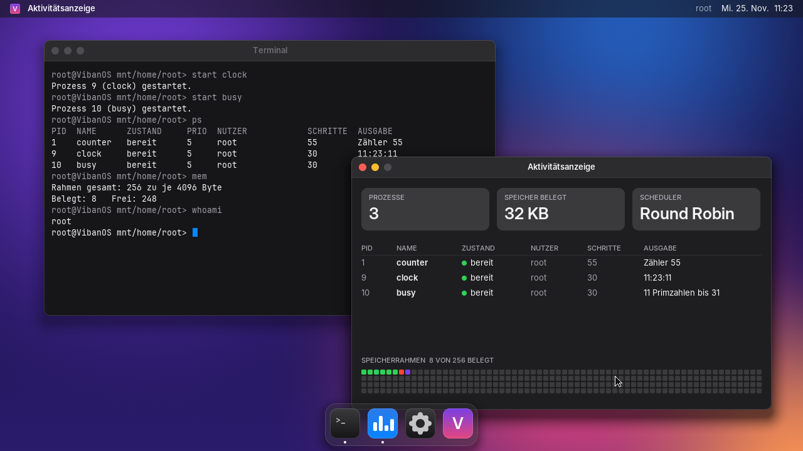
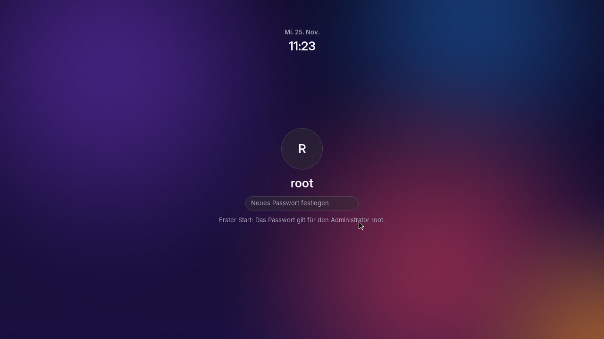
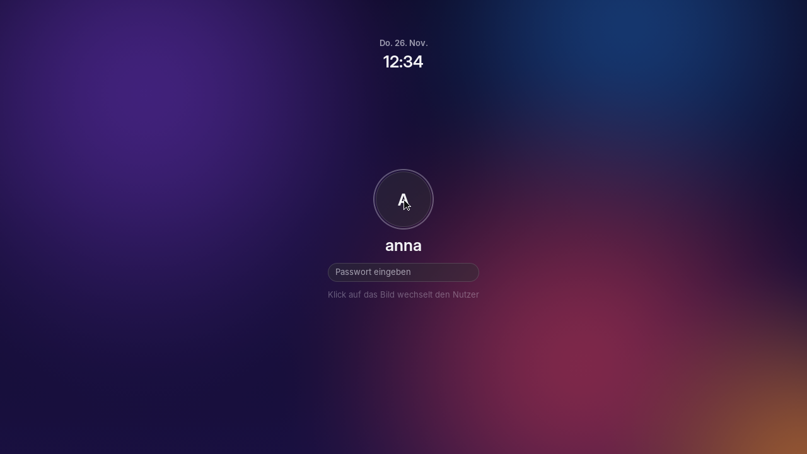
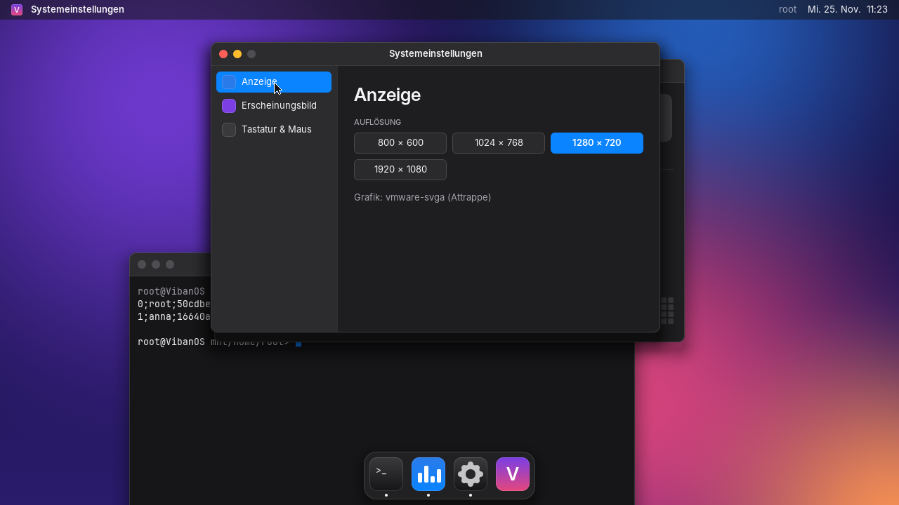
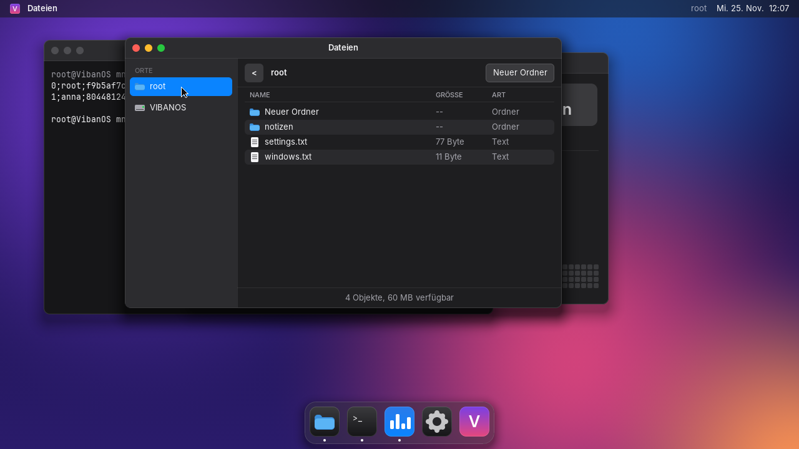
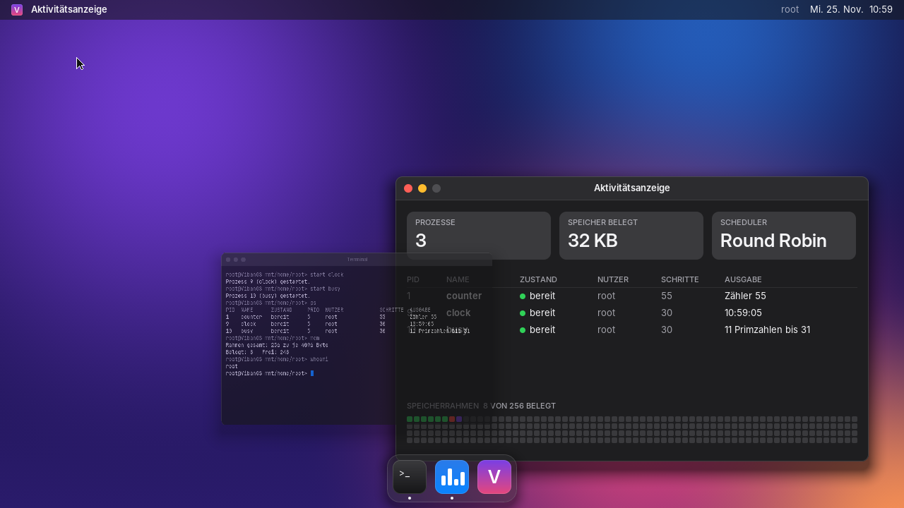

# VibanOS Designsheet

Dieses Blatt legt fest, wie VibanOS aussieht. Es gilt für alles, was auf dem Bildschirm erscheint.
Die Werte stehen als Konstanten in [`VibanOS/Design/Tokens.cs`](../../VibanOS/Design/Tokens.cs). Code und Blatt müssen übereinstimmen.



So sieht es zusammengesetzt aus:











## Regeln

1. **Nur Tokens.** In `VibanOS/Gui/` stehen keine rohen Farbwerte. Abstände, Radien und Maße kommen aus `T.Space.…`, `T.Radius.…` und `T.Size.…` (`using T = VibanOS.Design.Tokens;`). Maße, die nur ein einzelner Baustein kennt (etwa die Kästchengröße der Speicherkarte), stehen dort als benannte Konstante.
2. **Fehlt ein Wert, kommt ein neues Token dazu**, erst in `Tokens.cs`, dann in diesem Blatt. Kein Einzelwert im Fenstercode.
3. **Farbe hat Bedeutung.** Blau (`Accent`) markiert, womit man gerade arbeitet. Rot, Gelb und Grün stehen für Fehler, Warnung und Erfolg. Alles andere ist grau abgestuft.
4. **Ruhe vor Schmuck.** Dunkle, ruhige Flächen, viel Abstand, runde Ecken, weiche Schatten. Text ist linksbündig, Zahlen und Beschriftungen stehen in einer Flucht.
5. **Abstände kommen aus dem 4-px-Raster.** Innen in Fenstern `L` (16), zwischen zusammengehörigen Dingen `S` oder `M`, zwischen Abschnitten `L` oder `XL`.

## Farben

Alle Farben sind `0xAARRGGBB`. Werte mit Deckkraft unter `FF` scheinen durch.

### Akzent und Status

| Token | Wert | Einsatz |
| -- | -- | -- |
| `Accent` | eine der Akzentfarben, anfangs `AccentBlue` | Einfügemarke, Hauptknopf, Hervorhebung. Als einzige Farbe veränderlich: Die Systemeinstellungen setzen sie |
| `AccentBlue`, `AccentPurple`, `AccentPink` | `#0A84FF`, `#BF5AF2`, `#FF375F` | zur Wahl in den Systemeinstellungen |
| `AccentOrange`, `AccentGreen`, `AccentGraphite` | `#FF9F0A`, `#32D74B`, `#8E8E93` | zur Wahl in den Systemeinstellungen |
| `Success` | `#30D158` | läuft, bereit, erfolgreich |
| `Warning` | `#FFD60A` | blockiert, Achtung |
| `Danger` | `#FF453A` | Fehler, abgelehnt |

### Flächen

| Token | Wert | Einsatz |
| -- | -- | -- |
| `Window` | `#1E1E20` | Fensterinhalt |
| `TitleBar` | `#2C2C2F` | Titelleiste |
| `Sunken` | `#161618` | vertiefte Flächen: Terminal, Eingabefelder |
| `Raised` | `#3A3A3D` | erhöhte Flächen: Kacheln, freie Speicherrahmen, gewähltes Feld einer Auswahl |
| `Grouped` | `#2A2A2D` | Gruppen und nicht gewählte Auflösungen in den Systemeinstellungen |
| `Track` | `#48484C` | ausgeschalteter Schalter |
| `MenuBar` | `#161618`, 55 % | Menüleiste, durchscheinend |
| `Dock` | `#303034`, 45 % | Dock, Avatar und Feld auf dem Anmeldebildschirm |
| `Scrim` | `#000000`, 40 % | Abdunklung des Hintergrunds beim Anmelden |
| `Border` | `#FFFFFF`, 14 % | 1-px-Rahmen um Fenster, Dock, Symbole, Felder |
| `Separator` | `#FFFFFF`, 8 % | Trennlinien in Fenstern |

### Text

| Token | Wert | Einsatz |
| -- | -- | -- |
| `TextPrimary` | `#F5F5F7` | Inhalt, Titel |
| `TextSecondary` | `#EBEBF5`, 65 % | Beschriftungen, Nebeninformation |
| `TextTertiary` | `#EBEBF5`, 35 % | inaktiv, Platzhalter, leere Zustände |
| `TextOnAccent` | `#FFFFFF` | Text und Zeichen auf farbigen Flächen |

### Fensterknöpfe

| Token | Wert | Einsatz |
| -- | -- | -- |
| `Close` | `#FF5F57` | Schließen |
| `Minimize` | `#FEBC2E` | Verkleinern |
| `Zoom` | `#28C840` | Vergrößern |
| `ControlInactive` | `#4E4E52` | alle drei Knöpfe in inaktiven Fenstern |

### Hintergrundbild, Symbole, Schatten, Mauszeiger

| Token | Wert | Einsatz |
| -- | -- | -- |
| `WallBase1`, `WallBase2` | `#140F3D`, `#2A1B6B` | Grundverlauf von oben nach unten |
| `WallBlob1` bis `WallBlob4` | `#7B3FE4`, `#E4477E`, `#FF9552`, `#2A7BEA` | weiche Farbflecken. `WallBlob1` → `WallBlob2` ist auch der Verlauf des Logos |
| `Folder`, `FolderBack` | `#5AB4F5`, `#3A8FDB` | Ordnersymbol in der App Dateien und im Dock: vorn die Mappe, dahinter Reiter und Rückseite |
| `Shadow` | `#000000` | Schattenfarbe, die Deckkraft kommt aus `T.Shadow` |
| `CursorFill`, `CursorEdge` | `#111113`, `#FFFFFF` | Mauszeiger |

## Schrift

Zwei Schriftfamilien, fünf Rollen. Andere Größen gibt es nicht.

| Rolle | Schrift | Einsatz |
| -- | -- | -- |
| `Fonts.Display` | Inter Display SemiBold 26 | große Zahlen, Namen, Uhr auf dem Anmeldebildschirm |
| `Fonts.Strong` | Inter SemiBold 13 | Fenstertitel, Menüleiste, hervorgehobene Werte |
| `Fonts.Body` | Inter Regular 13 | normaler Text |
| `Fonts.Caption` | Inter Medium 11 | Spaltenköpfe und Kachel-Beschriftungen, in Großbuchstaben |
| `Fonts.Mono` | JetBrains Mono Regular 13 | Terminal |

Die Schriften sind als geglättete Atlanten in `VibanOS/Graphics/FontData.cs` einkompiliert und decken Latin-1 ab (also auch ä, ö, ü, ß).
Jede Rolle gibt es zusätzlich doppelt so groß für Retina-Bildschirme. Alle Größen und Maße in diesem Blatt sind Punkte: Auf einem Retina-Bildschirm zeichnet VibanOS jeden Punkt mit 2x2 Pixeln, die Oberfläche bleibt gleich groß und wird schärfer.
Wer eine Größe ändert, passt `tools/make-fonts.py` an und führt es aus, das Skript schreibt die Datei neu. Inter und JetBrains Mono stehen unter der SIL Open Font License.

## Abstände, Radien, Maße

| Abstand | px | | Radius | px | Einsatz |
| -- | -- | -- | -- | -- | -- |
| `Space.XS` | 4 | | `Radius.XS` | 2 | Kleinteile: Balken, Kästchen der Speicherkarte |
| `Space.S` | 8 | | `Radius.S` | 6 | Knöpfe, Farbfelder |
| `Space.M` | 12 | | `Radius.M` | 10 | Fenster, Kacheln |
| `Space.L` | 16 | | `Radius.L` | 18 | Dock |
| `Space.XL` | 24 | | `Radius.Icon` | 11 | App-Symbole bei 48 px, skaliert mit der Größe |
| `Space.XXL` | 32 | | | | |

Eingabefelder sind Pillen: Der Radius ist die halbe Höhe.

| Maß | px | Einsatz |
| -- | -- | -- |
| `Size.ScreenWidth` × `Size.ScreenHeight` | 1280 × 720 | Entwurfsgröße: Wunschauflösung beim Start und Größe der Vorschaubilder. Bietet die Grafikkarte sie nicht, richtet sich die Oberfläche nach der echten Größe. Die Systemeinstellungen bieten 800 × 600 bis 1920 × 1200 an |
| `Size.MenuBar` | 28 | Höhe der Menüleiste |
| `Size.TitleBar` | 34 | Höhe der Titelleiste |
| `Size.Control`, `Size.ControlGap` | 12, 8 | Durchmesser und Abstand der Fensterknöpfe |
| `Size.DockIcon`, `Size.DockIndicator` | 48, 4 | Symbol im Dock und der Punkt „App läuft“ |
| `Size.Field` | 30 | Höhe von Eingabefeldern und Knöpfen |
| `Size.Caret` | 2 | Breite der Einfügemarke im Eingabefeld, hoch wie eine Zeile `Fonts.Body` |
| `Size.Row` | 24 | Zeilenhöhe in Listen und Tabellen |
| `Size.Avatar` | 88 | Nutzerbild auf dem Anmeldebildschirm |
| `Size.AvatarSmall` | 64 | Nutzerbild in der Nutzerwahl des Anmeldebildschirms, der gewählte Nutzer hat einen Ring in `Accent` |
| `Size.Sidebar` | 180 | Seitenleiste der Systemeinstellungen und der App Dateien |
| `Size.ToggleWidth`, `Size.ToggleHeight` | 38, 22 | Schalter an/aus, die Höhe gilt auch für die Auswahl Deutsch/US |
| `Size.Swatch` | 20 | Farbpunkt der Akzentfarbe und Symbol in der Seitenleiste |
| `Size.CursorScale` | 2 | Vergrößerung des großen Mauszeigers |

## Schatten

| Token | Unschärfe | Versatz | Deckkraft |
| -- | -- | -- | -- |
| Fenster, aktiv | 30 | 12 | 130 von 255 |
| Fenster, inaktiv | 30 | 12 | 70 von 255 |
| Dock | 20 | 6 | 80 von 255 |

Der Schatten zeigt, was vorn liegt. Das aktive Fenster hat den kräftigsten. Gezeichnet wird er nur außerhalb der Form, durch das durchscheinende Dock scheint er also nicht hindurch.

## Bewegung

Fenster bewegen sich kurz und ruhig, nie verspielt. Die Werte stehen in `T.Motion`.

| Token | Wert | Bewegung |
| -- | -- | -- |
| `Motion.Open` | 200 ms | Öffnen: wächst von `StartScale` auf volle Größe und blendet ein, bremst sanft ab |
| `Motion.Close` | 150 ms | Schließen: schrumpft auf `StartScale` und blendet aus |
| `Motion.Minimize` | 300 ms | Gelber Knopf: das Fenster zieht sich auf sein Dock-Symbol zusammen und wird dabei blasser, ein Klick auf das Symbol holt es auf demselben Weg zurück. Beschleunigt und bremst |
| `Motion.Zoom` | 250 ms | Grüner Knopf: das Fenster wächst auf die Fläche zwischen Menüleiste und Dock (Rand `S`), ein zweiter Klick stellt die alte Größe her |
| `Motion.StartScale` | 90 % | Größe am Anfang des Öffnens und am Ende des Schließens |
| `Motion.DockAlpha` | 90 von 255 | Deckkraft, wenn das Fenster im Dock ankommt |
| `Motion.Appear` | 300 ms | Anmeldebildschirm nach dem Abmelden oder Nutzerwechsel mit Tab: Bild, Name und Feld blenden ein und steigen um `Space.L` nach oben |
| `Motion.Picker` | 280 ms | Nutzerwahl: Die Bilder fächern sich aus dem großen Nutzerbild in ihre Felder auf und werden dabei kleiner, Namen blenden erst in der zweiten Hälfte ein. Beim Schließen fallen sie in das gewählte Bild zurück, das wieder groß wird |
| `Motion.Shake` | 400 ms | Falsches Passwort oder Eingabe: Das Feld schüttelt sich dreimal um höchstens `Space.S`, immer schwächer, wie bei macOS |
| `Motion.Hover` | 120 ms | Nutzerbild unter der Maus: In der Nutzerwahl wächst es um `Space.XS` je Seite und bekommt den Ring in `Accent`, auf der Anmeldung zeigt ein Ring in `TextTertiary`, dass es klickbar ist |
| `Motion.Fade` | 150 ms | Neuer Platzhalter im Feld (nächster Schritt beim Anlegen, Passwort wiederholen) blendet ein |
| `Motion.Blink` | 500 ms | Einfügemarke im Eingabefeld: so lange an, dann so lange aus. Jede Taste fängt den Takt von vorn an, beim Tippen steht sie also still. Neu gezeichnet wird dabei nur die Marke |



Öffnen, Schließen und Minimieren zeichnen ein Standbild des Fensters, das einmal am Anfang entsteht, gestreckt und durchscheinend. Der Inhalt bleibt so lange stehen. Zoom verändert das echte Fenster, der Inhalt wächst mit. Die Dauer richtet sich nach der Uhr, nicht nach der Bildrate: Ist die VM langsam, zeigt sie weniger Zwischenbilder, die Animation dauert aber gleich lang.

## Bausteine

- **Fenster** (`Gui/Window.cs`): Radius `M`, Titelleiste in `TitleBar` mit zentriertem Titel in `Fonts.Strong`, links die drei Knöpfe mit Abstand `M` zum Rand. 1-px-Rahmen in `Border`, darunter der Schatten. Inaktive Fenster: Knöpfe grau, Titel in `TextTertiary`, schwächerer Schatten. Der grüne Knopf ist auch im aktiven Fenster grau, wenn der Inhalt nicht mitwächst (nur das Terminal lässt sich zoomen).
- **Menüleiste**: volle Breite, durchscheinend. Links Logo und Titel des aktiven Fensters, rechts Nutzer (`TextSecondary`), Datum und Uhrzeit.
- **Dock**: mittig am unteren Rand, Abstand `S` zum Rand, Radius `L`, durchscheinend mit Rahmen. Symbole 48 px mit Abstand `M`. Ein kleiner Punkt zeigt, dass die App offen ist.
- **App-Symbol** (`Gui/Icons.cs`): abgerundetes Quadrat mit senkrechtem Verlauf, 1-px-Rahmen, ein einfaches helles Zeichen. Symbole werden gezeichnet, nicht als Bild geladen.
- **Kachel**: Fläche `Raised`, Radius `M`, innen `M`. Oben die Beschriftung in `Fonts.Caption`, darunter der Wert in `Fonts.Display`.
- **Tabelle**: Kopfzeile in `Fonts.Caption` und `TextSecondary`, darunter eine Linie in `Separator`. Zeilen in `Size.Row`. Ein farbiger Punkt vor dem Zustand.
- **Terminal**: Fläche `Sunken`, Schrift `Fonts.Mono`, Rand `M`. Ausgaben in `TextPrimary`, frühere Eingaben und Hinweise in `TextSecondary`, Fehler in `Danger`, Einfügemarke in `Accent`.
- **Eingabefeld**: Höhe `Size.Field`, Pillenform, 1-px-Rahmen. Platzhalter in `TextSecondary`. Die Einfügemarke in `Accent` wie im Terminal, `Size.Caret` breit, blinkt im Takt `Motion.Blink`. Im leeren Feld steht sie direkt vor dem Platzhalter, sonst hinter dem letzten Zeichen oder Punkt. Nimmt das Feld gerade nichts an (Nutzerwahl offen, Sperre nach Fehlversuchen), fehlt sie.
- **Systemeinstellungen** (`Gui/SettingsWindow.cs`): links eine Seitenleiste in `TitleBar`, Breite `Size.Sidebar`, die gewählte Seite als Fläche in `Accent` mit Radius `S`. Rechts der Seitentitel in `Fonts.Display`, darunter Gruppen in `Grouped` mit Radius `M` und Rahmen, Zeilen von `Size.Field` + `Space.M`, getrennt durch `Separator`. Beschriftung links in `Fonts.Body`, das Bedienelement rechtsbündig mit Abstand `L`. Eine Meldung steht unter dem Inhalt der Seite: ein Fehler in `Danger`, ein Hinweis in `Warning`.
- **Dateien** (`Gui/FilesWindow.cs`): dieselbe Seitenleiste mit den Orten. Rechts oben eine Leiste von `Size.Field` + 2 × `Space.S` mit Zurück-Knopf und „Neuer Ordner“ in `Raised`, Radius `S`. Ist eine Zeile gewählt, stehen links davon „Umbenennen“ und „Löschen“, so breit wie ihre Beschriftung plus 2 × `Space.M`, mit Abstand `Space.S`. Beim Umbenennen steht an der Stelle des Namens ein Feld in `Sunken` mit Rahmen in `Border`, Radius `S`, `Space.XS` niedriger als die Zeile, die Einfügemarke in `Accent` steht still wie im Terminal. Die Rückfrage vor dem Löschen ersetzt die Statuszeile: links die Frage in `TextPrimary`, rechts „Abbrechen“ in `Raised` und „Löschen“ in `Danger` mit Text in `TextOnAccent`, beide `Size.Row` hoch. Rot, weil sich Löschen nicht rückgängig machen lässt. Darunter die Liste in Zeilen von `Size.Row`, jede zweite in `Grouped`, die gewählte in `Accent`. Die Vorschau einer Datei steht in `Fonts.Mono` auf `Sunken` wie im Terminal und bricht lange Zeilen genauso um. Die Spalte „Art“ nennt nur Endungen bis vier Zeichen, damit sie in ihre Breite passt. Unten eine Statuszeile in `TextSecondary`, Meldungen dort in `Danger`. Ein leerer Ordner und eine leere Datei sagen das mittig in `TextTertiary`.
- **Schalter**: Pille `Size.ToggleWidth` × `Size.ToggleHeight`, an in `Accent`, aus in `Track`, weißer Knopf (`TextOnAccent`).
- **Auswahl** (zwei Felder, z. B. Deutsch/US): Pille in `Sunken`, das gewählte Feld in `Raised` und `Fonts.Strong`, das andere in `TextSecondary`.
- **Auflösungen**: Felder in drei Spalten, Höhe `Size.Field`, Radius `S`. Die aktuelle Auflösung in `Accent`, die übrigen in `Grouped` mit Rahmen.

## Nicht vorgesehen

- Ein helles Erscheinungsbild. Die Flächen- und Text-Tokens sind so benannt, dass man sie dafür später austauschen kann.
- Echte Unschärfe hinter durchscheinenden Flächen und aufwendige Animationen wie der verbogene „Flaschengeist“ beim Minimieren. Beides ist unter COSMOS ohne Grafikbeschleunigung zu langsam.

## Bilder neu erzeugen

```sh
dotnet run --project tools/Preview
```

Das schreibt die Bilder nach `preview/`. Nach einer Änderung am Design `designsheet.png`, `4-schreibtisch.png` (als `schreibtisch.png`), `1-anmeldung.png` (als `anmeldung.png`), `5-minimieren.png` (als `minimieren.png`) und `6-einstellungen.png` (als `einstellungen.png`) von dort nach `docs/design/` kopieren.
