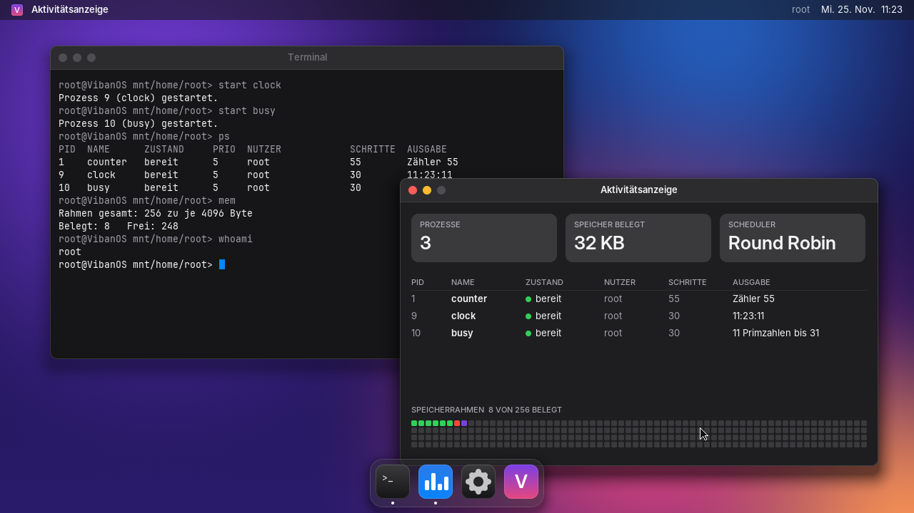

# VibanOS

VibanOS ist ein eigenes Betriebssystem, geschrieben in C# mit [COSMOS](https://github.com/CosmosOS/Cosmos) 3.0. Es startet in einer virtuellen Maschine (QEMU) und hat eine dunkle Oberfläche, die an macOS angelehnt ist: Anmeldebildschirm, Schreibtisch mit Menüleiste und Dock, Fenster, Terminal und Dateien.

## Was VibanOS schon kann

| Bereich | Was es gibt |
| -- | -- |
| Oberfläche | Schreibtisch, Fenster zum Ziehen und Schließen, Dock, Menüleiste mit Uhr |
| Apps | Terminal, Dateien, Aktivitätsanzeige, Systemeinstellungen, „Über VibanOS“ |
| Shell | Befehle wie `help`, `ls`, `cp`, `mv`, `rm`, `df`, `useradd`, `passwd`, `sudo`, `shutdown` |
| Nutzer | Anmeldung mit Passwort, Nutzer und Gruppen, Rechte |
| Festplatte | FAT-Dateisystem auf `disk.img`, eigener Ordner je Nutzer |
| Kern | Prozesse und Scheduler, Speicherverwaltung, Systemaufrufe, Mailbox, Mutex, Semaphore |
| Einstellungen | Auflösung, Akzentfarbe, Tastatur Deutsch/US, großer Mauszeiger, je Nutzer gespeichert |

Wie die Teile zusammenhängen, steht in der [Architektur](architektur.html). Wie alles aussieht, legt das [Designsheet](design/designsheet.html) fest.

## Wie wir arbeiten

- Der Code liegt auf [GitHub](https://github.com/DHGE2025/VibanOS), gearbeitet wird auf dem Branch `development`.
- Die Aufgaben stehen in Linear im Team **VIB**, jede hat eine Kennung wie `VIB-23`.
- Mit der **Werkstatt** holt, baut und startet man jeden Branch per Klick.
- Jede Änderung kommt als Pull Request gegen `development` und wird von Antonio geprüft.

Wie das Schritt für Schritt geht, steht unter [Implementierung](implementierung.html).

## Team

| Name | Rolle | GitHub |
| -- | -- | -- |
| Antonio | Lead Developer | [TheScoutSky](https://github.com/TheScoutSky) |
| Basti | Entwickler | [Sebastian69479](https://github.com/Sebastian69479) |
| Niclas | Entwickler | [Reso0007](https://github.com/Reso0007) |
| Vicken | Entwickler | |
| Finn | Entwickler | [honigkuchenpferd64](https://github.com/honigkuchenpferd64) |

Antonio leitet das Projekt, übernimmt die schwersten Aufgaben im Kern und prüft jeden Pull Request.
